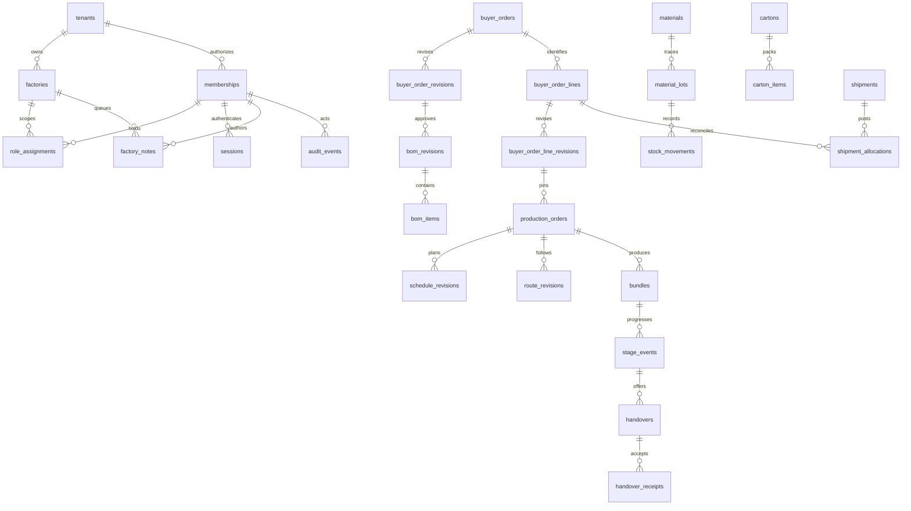

# Data model

Only identity, factory scope, sessions, development work notes and audit are implemented. Manufacturing records below are planned logical relationships.

Implemented tenant-owned tables have non-null tenant IDs, composite primary/foreign keys, ENABLE + FORCE RLS and tenant-local transaction context. The runtime has no table ownership/BYPASSRLS and no DDL rights. `tenants` is a root directory inaccessible directly to the runtime; a fixed-search-path SECURITY DEFINER function resolves a slug for password authentication. A selected slug grants no business access by itself. A signed random cookie is verified before selecting a tenant for session lookup, then the stored hash, expiry and active membership are checked.

Current membership rows combine account credentials and tenant membership for this bounded slice; global multi-business identities, legal entities and invitations are not implemented. IDs and actor references remain immutable. Password hashes are never returned to the UI. Sessions expire after eight hours and are revoked on logout/disable. Notes and audit retain history; no user-delete endpoint exists. Retention and account recovery policy remain open decisions.
